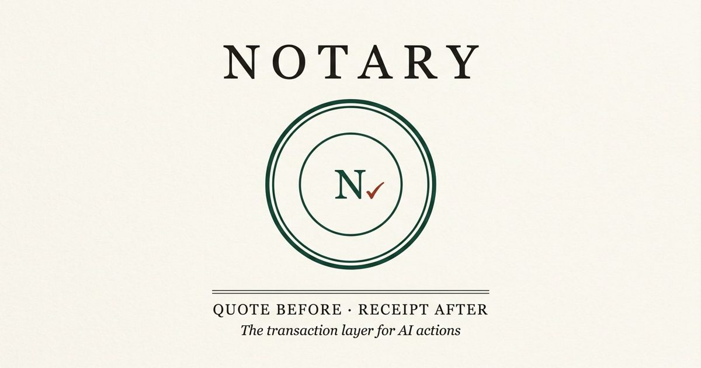
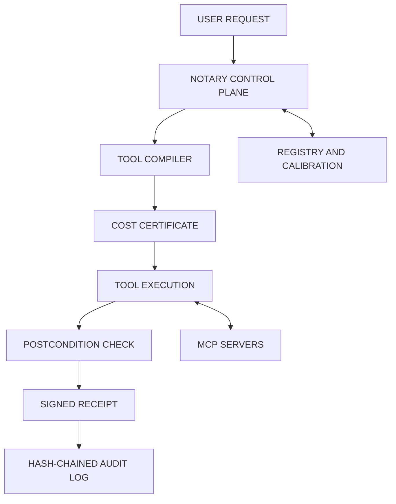

# NOTARY

<p align="center">
  
</p>

<p align="center">
  
  
  
  
</p>

<p align="center">
  <strong>THE TRANSACTION LAYER FOR AI ACTIONS.</strong><br />
  QUOTE BEFORE. VERIFY AFTER. KEEP A RECEIPT.
</p>

NOTARY BRINGS DATABASE-STYLE TRANSACTION DISCIPLINE TO AI TOOL CALLS. IT CHECKS THE PLAN, ESTIMATES THE COST, VERIFIES THE RESULT, AND KEEPS AN AUDITABLE RECEIPT.

**wHACKIEST 2026 · TRACK 1 — MAKE MCP MATTER: LESS MAGIC, MORE UTILITY**

**TEAM MAS CODERS** · SHIV NADAR UNIVERSITY CHENNAI  
ABDUL RAHUMAN M (LEAD) · MAHASWIN .SUJITH

---

## THE PROBLEM

AI AGENTS CAN NOW TAKE ACTIONS IN EMAIL, CRMS, PAYMENTS, AND OTHER REAL SYSTEMS. BUT A SIMPLE “DONE!” DOES NOT PROVE THAT THE ACTION WORKED.

- **HIGH CONTEXT COST:** TOOL DESCRIPTIONS CAN USE A LARGE PART OF THE MODEL'S CONTEXT WINDOW. THREE COMMON MCP SERVERS WERE REPORTED TO USE 143,000 OF 200,000 TOKENS (72%) BEFORE THE USER ENTERED A PROMPT ([AGENTPMT](https://agentpmt.com), FEB 2026).
- **TOO MANY TOOLS:** TOOL SELECTION BECOMES LESS RELIABLE AS THE AVAILABLE TOOLSET GROWS.
- **NO PROOF OF SUCCESS:** A TOOL CAN RETURN `200 OK` EVEN WHEN THE REQUESTED CHANGE WAS NEVER SAVED.

THE RESULT: TEAMS STRUGGLE TO ANSWER TWO BASIC QUESTIONS:

**WHAT WILL THIS ACTION COST? DID IT ACTUALLY HAPPEN?**

## THE NOTARY APPROACH

NOTARY ADDS THREE STEPS TO AN AI ACTION:

| STEP | WHAT HAPPENS |
|---|---|
| **1. QUOTE** | SELECT A SMALL, RELEVANT SET OF TOOLS WITHIN A TOKEN BUDGET. |
| **2. CERTIFY** | ESTIMATE THE EXPECTED COST BEFORE THE ACTION STARTS, WITH A CALIBRATED 95% CONFIDENCE TARGET. |
| **3. RECEIPT** | CHECK THE RESULT AGAINST A POSTCONDITION, THEN CREATE A SIGNED, HASH-CHAINED AUDIT RECEIPT. |

A `200 OK` IS NOT ENOUGH. NOTARY READS THE RESULT BACK AND CHECKS WHETHER THE EXPECTED CHANGE REALLY EXISTS.

THE COMPILER IS DETERMINISTIC CODE. IT DOES NOT NEED AN EXTRA LLM CALL.

## SEE IT IN ACTION

THE WORKING PROTOTYPE RUNS AGAINST A MOCK MCP ENVIRONMENT WITH **86 TOOLS**, INCLUDING SLACK, NOTION, CRM, DRIVE, JIRA, GMAIL, STRIPE, POSTGRES, AND GITHUB.

### 1. BASELINE VS NOTARY

COMPARE THE SAME TASK WITH AND WITHOUT NOTARY. IN BASELINE MODE, A SILENT FAILURE CAN BE REPORTED AS SUCCESS. IN PROTECTED MODE, NOTARY CHECKS THE ACTUAL RESULT.

### 2. THE DEMO CONSOLE

THE DEMO HAS THREE BEATS:

- **THE BOMB:** SEE THE FULL TOOL CATALOG REDUCED TO A SMALLER COMPILED SET, WITH A COST CERTIFICATE.
- **THE LIE DETECTOR:** INJECT A SILENT FAILURE. NOTARY READS THE STATE BACK, FLAGS THE MISSING CHANGE, AND TRIES A BOUNDED RETRY.
- **THE VOICE:** HEAR THE FINAL RECEIPT USING BROWSER SPEECH SYNTHESIS. THE `speak()` FUNCTION IS THE DOCUMENTED INTEGRATION POINT FOR ELEVENLABS.

### 3. COMPILER PLAYGROUND

ENTER A REQUEST AND INSPECT THE SELECTED TOOLS, RELEVANCE SCORES, TOKEN COSTS, EXCLUDED TOOLS, AND CERTIFICATE BREAKDOWN.

### 4. RECEIPTS LEDGER

VIEW SIGNED RECEIPTS, CHECK THE SHA-256 HASH CHAIN, AND EXPORT RECEIPTS AS JSON.

### 5. HOW IT WORKS

EXPLORE THE ALGORITHMS, FORMULAS, LIMITATIONS, INTEGRATION NOTES, AND METRICS.

## QUICK START

YOU NEED NODE.JS INSTALLED.

```bash
npm install
npm run dev
```

OPEN `http://localhost:5173`.

### OTHER COMMANDS

```bash
npm run build        # PRODUCTION BUILD
npm test              # RUN TESTS
npm run smoke         # OFFLINE SMOKE TEST
npm run serve         # START HTTP API ON :8787
npm run example:mcp   # RUN THE MCP GATE EXAMPLE
npm run train         # TRAIN THE LEARNED SCORER
npm run calibrate     # CHECK CERTIFICATE CALIBRATION
```

**NO API KEYS ARE REQUIRED FOR THE DEMO.**

CI RUNS THE BUILD, TESTS, AND SMOKE TEST ON EVERY PUSH.

## HOW IT FITS TOGETHER



THE PROTOTYPE USES A MOCK BACKEND. THE PLANNED PRODUCTION MAPPING INCLUDES AWS BEDROCK, GUARDRAILS, OPENSEARCH, DYNAMODB, LAMBDA/FARGATE, STEP FUNCTIONS, EVENTBRIDGE, CLOUDWATCH, COGNITO, AND ELEVENLABS.

## THE CORE IDEAS

### TOOL SELECTION

NOTARY SELECTS TOOLS BY BALANCING RELEVANCE AND REDUNDANCY UNDER A TOKEN BUDGET:

```text
MAXIMISE F(S) = RELEVANCE - REDUNDANCY
SUBJECT TO TOTAL TOOL COST <= TOKEN BUDGET
```

THE SELECTOR USES A GREEDY APPROACH WITH SMALL-SEED ENUMERATION. THE DESIGN TARGET IS A `(1 - 1/e)` APPROXIMATION UNDER ITS STATED CONDITIONS.

### COST CERTIFICATE

THE CERTIFICATE ESTIMATES THE COST BEFORE EXECUTION. IT USES PER-TOOL CALIBRATION AND A UNION-BOUND APPROACH TO TARGET A 5% BREACH PROBABILITY (`α = 0.05`).

### EFFECT VERIFICATION

EACH WRITE ACTION HAS A PRECONDITION AND A POSTCONDITION:

```text
PRECONDITION → TOOL CALL → READ-BACK → POSTCONDITION
```

IF THE EXPECTED CHANGE IS MISSING, NOTARY MARKS THE RESULT AS CONTRADICTED, TRIES A BOUNDED RETRY, OR ESCALATES IT.

## METRICS

| METRIC | TARGET |
|---|---:|
| TOOL CONTEXT | ≤ 8% |
| TASK SUCCESS | AT LEAST BASELINE |
| CERTIFICATE BREACHES | ≤ 5% AT α = 0.05 |
| CONTROL-PLANE OVERHEAD | < 500 MS P95 |
| WARM COMPILATION TIME | ABOUT 9 MS |

THESE ARE PROJECT TARGETS AND MEASURED PROTOTYPE METRICS, NOT UNIVERSAL GUARANTEES.

## WHAT NOTARY DOES NOT CLAIM

- IT DOES NOT VERIFY EVERY POSSIBLE REAL-WORLD OUTCOME. POSTCONDITIONS ARE DEFINED PER SUPPORTED WRITE TOOL.
- IT DOES NOT ALWAYS FIND THE OPTIMAL TOOL SET. IT USES AN APPROXIMATION WITH STATED CONDITIONS.
- IT DOES NOT PROMISE A HARD TOKEN CEILING. IT PROVIDES A CALIBRATED COST ESTIMATE WITH A PUBLISHED BREACH TARGET.
- IT DOES NOT REPLACE MCP OR EXISTING TOOL-SEARCH SYSTEMS. IT ADDS A COMMITMENT AND VERIFICATION LAYER.

## TECHNOLOGY

- **CORE:** JAVASCRIPT, REACT, VITE, NODE.JS
- **TOOL LAYER:** MCP-STYLE MOCK SERVERS AND A DETERMINISTIC TOOL COMPILER
- **VERIFICATION:** POSTCONDITIONS, READ-BACK CHECKS, SHA-256 HASH-CHAINED RECEIPTS
- **PLANNED CLOUD INTEGRATION:** AWS SERVICES AND ELEVENLABS VOICE

## PROJECT DOCUMENTATION

- [ARCHITECTURE](docs/ARCHITECTURE.md)
- [EVALUATION](docs/EVALUATION.md)
- [INTEGRATION](docs/INTEGRATION.md)
- [PITCH AND DEMO SCRIPT](docs/PITCH.md)

## PROJECT STRUCTURE

```text
src/core/       COMPILER, CERTIFICATE, PLANNER, VERIFIER, RECEIPTS
src/App.jsx     DEMO CONSOLE AND PLAYGROUNDS
server/         HTTP API
integrations/   OPENAI TOOLS, MCP PROXY, OPENAPI SPEC
examples/       RUNNABLE EXAMPLES
data/           TRAINING DATA
scripts/        SMOKE, TRAINING, CALIBRATION, AND UI CHECKS

```

#
## DESIGN

THE INTERFACE IS INSPIRED BY A NOTARIAL DOCUMENT: PAPER, INK, CLEAR TYPOGRAPHY, DOUBLE RULES, AND STAMP-LIKE VERDICTS.

NO DISTRACTING GRADIENTS OR GLOW EFFECTS. THE DESIGN REFLECTS THE PRODUCT: CLEAR, FORMAL, AND AUDITABLE.

## LICENSE

MIT © 2026 MASCODERS  
ABDUL RAHUMAN M · MAHASWIN .SUJITH
SEE [LICENSE](LICENSE) FOR DETAILS.
